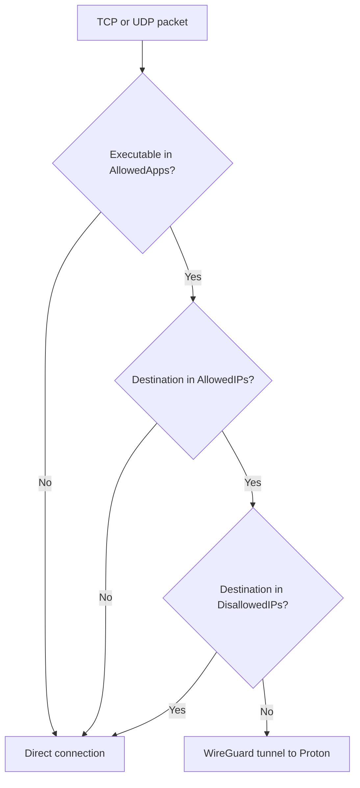
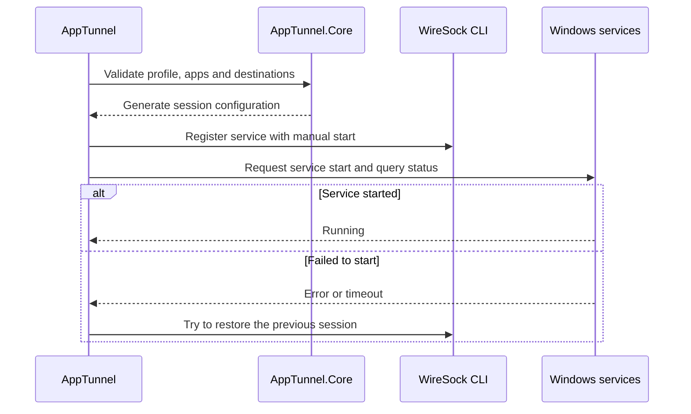

# AppTunnel

**English** · [Português](README.pt-BR.md)


Use **Proton VPN only in the apps you choose**, such as Serein, Discord or another compatible client. AppTunnel lets you pick the programs and the WireGuard route from its own window. WireSock keeps the connection running as a Windows service and puts the TCP and UDP traffic of the chosen programs into the tunnel.

**To get started, download the x64 installer from [Releases](https://github.com/F404X/app-tunnel/releases).** The guide below covers everything from installation to the first test.

## Before you install

- **64-bit Windows 10 or 11 (x64).** To check, open **Settings → System → About** and look at **System type**.
- **A Proton account.** You can create a free account and use any server your plan includes. [Create a Proton VPN account](https://protonvpn.com/free-vpn)
- **Windows administrator permission.** Windows asks for it because AppTunnel uses a network service.

## 1. Install AppTunnel

1. Open [Releases](https://github.com/F404X/app-tunnel/releases). Under **Assets**, download **AppTunnel-Setup-x64.exe**.
2. Double-click the downloaded file. Confirm the Windows administrator prompt and follow the installer steps.
3. On the last page, keep the options to install the **WireSock Secure Connect CLI** and the **Microsoft Edge WebView2 Runtime** checked, if they appear. WireSock routes the traffic into the VPN. WebView2 opens the Proton page inside AppTunnel. If Windows asks you to confirm the installation of either one, follow the on-screen instructions.
4. Click **Finish**. To open AppTunnel later, search for **AppTunnel** in the **Start** menu.

The installer includes .NET. If you were using the ZIP of version 0.4.0 or earlier, first close the Proton window and choose **Exit interface** from the tray menu. Your profiles and preferences are still available when you open the installed version.

### Portable version

Under **Assets**, download **AppTunnel-Windows-x64.zip**, right-click the file and choose **Extract all**. Open **AppTunnel.exe** from the extracted folder and keep all the files together. On a PC without WireSock or WebView2, install the components from the official links below or run the commands in PowerShell.

```powershell
winget install --id NTKERNEL.WireSockVPNClientCLI --exact --source winget
winget install --id Microsoft.EdgeWebView2Runtime --exact --source winget
```

AppTunnel requires WireSock CLI 3.8.2.1 or later. If Windows does not recognize `winget`, use the vendors' download pages or install **App Installer** from the Microsoft Store. [WireSock](https://wiresock.net/wiresock-secure-connect/download) · [WebView2](https://developer.microsoft.com/microsoft-edge/webview2/) · [WinGet help](https://learn.microsoft.com/en-us/windows/package-manager/winget/)

## 2. Choose the language

On first launch, the app uses the Windows language when it is Portuguese, English or Russian, and English otherwise. To change it, click **Language** in the side menu. The selector with flags also offers **English**, **Português** and **Русский**.

## 3. Choose the Proton server

A **WireGuard profile** stores the server address and the key needed to connect. You can reuse a profile from your Proton account, create one with the assistant, or import a file you already saved. Add at least two different servers to allow automatic switching. One server is enough to connect.

On first launch, the **setup assistant** checks WireSock and WebView2, opens the Proton login, and asks which apps should use the VPN. When it finishes, click **Connect now**. To run the assistant again, use **Settings → Run first-time setup**.

### Pick a route without opening the browser

1. Open **Servers → Choose route**. AppTunnel lists the servers your Proton account can use, with country, city, load and ping. Free accounts only see the free servers.
2. Click a server. AppTunnel creates the WireGuard configuration in your Proton account and saves it under **Servers** within a few seconds.

The list and the creation use the Proton session already saved in AppTunnel, in the background and without opening a window. AppTunnel never receives your password. If the session has expired, the Proton login window opens once; sign in and pick the route again. The key is generated on your PC and saved before the request is sent to Proton, so a route that was created never ends up without its key, even if the connection drops halfway.

### Create a profile in the Proton window

1. Open **Servers → More options → Proton account profiles…**. If the Proton login window appears, sign in to your account and complete the verification it asks for. Go back to AppTunnel and open **Proton account profiles…** again to see what already exists.
2. If you need a new profile, use **More options → Create in the Proton window…**. Give it a name you will recognize, such as `AppTunnel home`.
3. Click **Create with recommended server** to use the server Proton suggests. To choose the location, click **Choose another server…** and then **Create** next to the server in Proton's list.
4. Keep the window open until the profile shows up under **Servers**. The configuration is imported automatically when Proton shows it in full.

Each creation you confirm adds a persistent profile to your Proton account. Sign-in, sync, connection and route switching use the available profiles. If a creation gets no confirmation, check **Proton account profiles…** before trying again. To revoke a remote profile, open your account on Proton.

Profiles with a usable key are imported automatically. If you see **Original .conf required**, import the file you saved when you created it, or create a new profile. Proton uses a private key generated when the profile is created. [Official Proton guide](https://protonvpn.com/support/wireguard-configurations) · [Implementation of the configuration page](https://github.com/ProtonMail/WebClients/blob/main/packages/components/containers/vpn/WireGuardConfigurationSection/WireGuardConfigurationSection.tsx#L387-L404)

### Use a `.conf` file you already have

1. Open **Servers → More options → Import a .conf file…**.
2. Choose the original file downloaded from Proton and click **Open**.
3. The imported server appears in the list. If you prefer to generate the file in your browser, go to [Proton account downloads](https://account.protonvpn.com/downloads#wireguard-configuration) and use **WireGuard configuration**.

Keep `.conf` files in a private place. They contain the profile's private key.

## 4. Select the apps and connect

1. Open **Apps → Add app → Explore common apps…**. Check the detected apps and click **Apply selection**. The catalog lists Discord, PTB, Canary, Serein, Telegram, Signal and other clients. Dimmed cards are unavailable. For portable programs, use **Browse for an .exe…**, **From a running app…**, or drag the `.exe`, shortcut or folder onto the dashed area.
2. Turn on the switch for each app that should use the tunnel. The label shows **Via VPN** or **Direct**. To remove an app, click the **×** on its row. With **Whole folder…**, choose the application's own folder, because the rule covers the executables inside it.
3. Under **Servers**, leave **Automatic** to use the fastest server, or pin a server from the list.
4. Under **Home**, click the round button and wait for **Connected · Protected**. If an official Discord, PTB or Canary is open and included in the route, AppTunnel asks whether you want to restart it. Choose **Restart now** to rebuild the voice and video connection, or **Not now** to restart Discord later. Check **Remember my choice** to stop seeing the question. You can change the choice in **Settings → Connection**. With Serein, you can go straight to testing the call or the stream.

The **Server** card on the **Home** page shows the server in use, and the **Connection** card shows whether the handshake was confirmed. **Test** measures the ping to the server. To pin another server while connected, choose the row under **Servers** and click **Switch server** under **Home**. In **Automatic** mode, AppTunnel picks the fastest server when it connects and switches by itself when the current one gets slow or fails. If you change the apps, the protocol or the filters while connected, AppTunnel applies the changes by itself about 1.5 seconds after the last change, and the notice at the bottom offers **Undo**. IP fields are applied when you leave the field. To apply manually with **Apply changes**, clear **Apply changes automatically while connected** in **Settings → Connection**. Each server's latency refreshes by itself when you open AppTunnel and the **Servers** page, at most once a minute.

## How AppTunnel works under the hood

AppTunnel turns a **Proton WireGuard profile**, a list of **executables or folders** and **destination IP** filters into a session configuration. The C# interface prepares the file and controls the Windows service. WireSock applies the rules to TCP and UDP packets and handles the WireGuard communication with the Proton server. [Code that builds the configuration](https://github.com/F404X/app-tunnel/blob/main/src/AppTunnel.Core/WireGuardProfile.cs) · [WireSock documentation](https://wiresock.net/documentation/wiresock-secure-connect/advanced-parameters)

### How WireSock decides where each packet goes



| Rule | How AppTunnel builds it |
| --- | --- |
| `#@ws:AllowedApps` | Uses the full paths of the checked executables and folders. A folder includes the executables inside it, subfolders too. |
| `AllowedIPs` | Starts from the networks the profile allows. Each IP or range under **Via VPN** must fall inside one of them. IPv6 is included when it is enabled and the profile has both an IPv6 address and an IPv6 route. |
| `#@ws:DisallowedIPs` | Includes the IPs or ranges set to go through the direct connection. With the local network option on, it also includes preset ranges such as `192.168.0.0/16`. These exclusions apply even to checked executables. |

For example, with **Serein** checked, the **browser** unchecked and the **local network** set to go direct, the same rules produce these three results.

| Application | Example destination | Path |
| --- | --- | --- |
| Serein | Public IP of a voice server, inside `AllowedIPs` | Proton VPN |
| Browser | The same public IP | Direct connection |
| Serein | `192.168.1.10`, inside an excluded range | Direct connection |

These are the routing lines of the `[Peer]` section in that example, with one of the local network ranges.

```ini
AllowedIPs = 0.0.0.0/0
#@ws:AllowedApps = C:\Users\Ana\AppData\Local\Programs\Serein\serein.exe
#@ws:DisallowedIPs = 192.168.0.0/16
```

In the default transparent mode, AppTunnel leaves out the profile's `DNS` field and lets Windows or the application itself handle name resolution. The **Use the profile DNS** option turns on WireSock's DNS redirection. Destination rules use IPs and CIDR networks. [Filters in the configuration](https://github.com/F404X/app-tunnel/blob/main/src/AppTunnel.Core/WireGuardProfile.cs) · [WireSock parameters](https://wiresock.net/documentation/wiresock-secure-connect/advanced-parameters)

### From the Proton account to the session file

The account window runs in `AppTunnel.Proton.exe`, a non-elevated process that opens the official page in WebView2. After sign-in, it lists the profiles the page shows and imports the full configurations. When you confirm a creation in the assistant, AppTunnel prepares and submits the official form with the authenticated session, and Proton's page generates the key and registers the profile. The same validator handles sync and manual import, accepting one `[Interface]` section and a single `[Peer]`, with valid keys, addresses, destinations and endpoint. For AmneziaWG, the validator also checks the obfuscation parameters of the supported version. [Proton window](https://github.com/F404X/app-tunnel/blob/main/src/AppTunnel.Proton/Program.cs) · [Creation assistant](https://github.com/F404X/app-tunnel/blob/main/src/AppTunnel.Proton/AccountWindow.Creation.cs) · [WireGuard validator](https://github.com/F404X/app-tunnel/blob/main/src/AppTunnel.Core/WireGuardProfile.cs)


**DPAPI** also encrypts the profiles passed locally between the Proton window and the interface. The copy WireSock uses gets an **ACL**, Windows' list of access permissions. The `HKLM\SOFTWARE\AppTunnel` registry key stores the session metadata, including the owner's SID and the paths of WireSock and the configuration file. When it reopens, AppTunnel checks this data against the Windows service to recover the active route. [Profile storage](https://github.com/F404X/app-tunnel/blob/main/src/AppTunnel.Windows/ProfileStore.cs) · [Service control](https://github.com/F404X/app-tunnel/blob/main/src/AppTunnel.Windows/WireSockEngine.cs) · [DPAPI on Windows](https://learn.microsoft.com/en-us/windows/win32/api/dpapi/nf-dpapi-cryptprotectdata)

### What happens when you connect and switch routes



- Automatic apply, **Apply changes** and **Switch server** replace the configuration and restart the service. If the new session fails, AppTunnel tries to restore the previous one and shows **Apply changes** so you can try again. The **Connected · Protected** indicator comes from the service's `Running` state. To validate the path end to end, generate traffic in a checked app. [Service control](https://github.com/F404X/app-tunnel/blob/main/src/AppTunnel.Windows/WireSockEngine.cs)
- **Discord, PTB and Canary** get the restart option when they are open and have just joined the route, or when the server changed. Clients that were already in the previous session, on the same server, are not restarted. Restarting rebuilds connections that were already open. Serein is outside this flow. [Restart rules](https://github.com/F404X/app-tunnel/blob/main/src/AppTunnel.Windows/DiscordRestart.cs) · [Route application](https://github.com/F404X/app-tunnel/blob/main/src/AppTunnel.Windows/MainForm.cs)
- **Exit interface** closes the tray process. The WireSock service keeps running as an independent process. **Start with Windows** registers a per-user task that opens the interface in the tray when you sign in. [Tray](https://github.com/F404X/app-tunnel/blob/main/src/AppTunnel.Windows/AppTunnelApplicationContext.cs) · [Windows startup](https://github.com/F404X/app-tunnel/blob/main/src/AppTunnel.Windows/WindowsStartup.cs)

## Filtered networks and DPI

Select an option under **Servers → Advanced → Protocol**. After changing the option, click **Connect**. While the VPN is connected, the change is applied automatically.

| Option | Engine and requirements |
| --- | --- |
| **From profile** | Uses the protocol of the selected file. For Proton `.conf` profiles, that is WireGuard. |
| **WireGuard** | Uses UDP with WireSock and a compatible WireGuard profile. |
| **WireGuard with padding** | Uses WireSock's pre-handshake padding, compatible with regular WireGuard servers. It can be selected with a Proton `.conf`. |
| **AmneziaWG** | Import a `.conf` from a compatible AmneziaWG server. AppTunnel accepts the configuration with `S1`, `S2` and `H1` to `H4` as integer values. The parameters must match the server's. |
| **Automatic** | Starts with the selected profile and tries up to four combinations of protocol and endpoint. It uses only the imported profiles and, when compatible, tries WireGuard with padding on the same endpoint. |

In **Automatic** mode, import more than one profile to allow server switching. With the interface open or collapsed to the tray, a later failure identified in the logs can start a recovery round with the available alternatives. Split tunneling, filters and privacy options keep being applied on every attempt. Switching can interrupt calls or streams.

If the ping replies of the route in use stay above **400 ms for at least five seconds**, AppTunnel measures the other compatible servers in the background. If there is a faster alternative and the current route stays slow, it switches through WireSock. The measurements leave the active connection alone. The switch itself can briefly interrupt a call or stream because the service loads the new profile. The new route is kept only when WireSock logs the handshake response. Without that confirmation, AppTunnel restores the previous route.

**Diagnostics** separates a handshake response, no response after sending, an endpoint error, and a route or adapter error. AppTunnel uses recent WireSock events. When the logs do not expose these events, the panel shows **handshake status unavailable**. No response can also mean the server is down or the keys do not match.

Proton Stealth is available in Proton's official clients. The manual files Proton provides use WireGuard. AppTunnel uses those files in WireSock. WireGuard with padding and AmneziaWG also depend on UDP, and how well they work varies by network. [Proton protocols](https://protonvpn.com/support/how-to-change-vpn-protocols) · [Proton manual configuration](https://protonvpn.com/support/wireguard-manual-windows) · [WireSock parameters](https://wiresock.net/documentation/wiresock-secure-connect/advanced-parameters)

### DNS and IPv6 with split tunneling

The options below are under **Servers → Advanced**. The section opens collapsed to leave more room for the server list, and it appears expanded when there are destinations filled in under **Always via VPN** or **Never via VPN**.

- **Use the profile DNS (shared resolver)** sends the Windows shared resolver's queries to the profile's DNS through WireSock. The option requires the DNS to be inside the VPN destinations and can affect local names and queries from other apps that use the Windows resolver. Apps with their own DNS, such as DoH, follow their own settings and the traffic rules.
- **Block IPv6 without a route (prevents leaks)** applies outbound Windows Firewall rules to the checked executables when the session has no IPv6 route in the tunnel. It blocks `2000::/3` and requires rules for individual executables instead of folders. Disconnecting removes the rules the session created. If the WireSock service stops by itself, AppTunnel also removes the service, the session files and these rules. Use **Include IPv6 when available** to use the routes allowed by dual-stack profiles.
- Excluded destinations go through the direct connection. Switching servers replaces the service and can open a gap between sessions. These options reduce the leak paths described above and have a different scope from a kill switch.

[DNS and local network in WireSock](https://wiresock.net/documentation/guide/local-resources-unavailable.html) · [Route configuration](https://github.com/F404X/app-tunnel/blob/main/src/AppTunnel.Core/WireGuardProfile.cs) · [IPv6 rules](https://github.com/F404X/app-tunnel/blob/main/src/AppTunnel.Windows/Ipv6Firewall.cs)

## Tray and disconnecting

| What you want to do | Where to click |
| --- | --- |
| Collapse the window and stay connected | Close the window with the **X**. AppTunnel stays in the Windows tray near the clock. Check the hidden icons arrow if needed. |
| Hide the AppTunnel icon | Right-click it and choose **Hide Tray**. |
| Restore the window and the icon | Open `AppTunnel.exe` again. The existing instance is brought back. |
| Close the interface and keep the service | In the tray, choose **Exit interface**. |
| Open AppTunnel with Windows | Check **Start with Windows** in **Settings** or in the tray icon's context menu. The option is available in the installed version. |
| Stop the VPN | Click **Disconnect** in the dashboard or **Disconnect VPN** in the tray. |

With **Start with Windows** on, AppTunnel opens in the tray when you sign in to your Windows account. To turn the VPN on after restarting the PC, open AppTunnel and click **Connect**.

## Appearance

Under **Settings → Appearance**, the default theme follows the Windows color preference. There are also **Light** and **Dark** theme options.

## Updating AppTunnel

Open **Settings → Check for updates**. If there is a newer version with an installer on GitHub, AppTunnel downloads and verifies the file, including preview versions. Confirm when the install option appears and follow the wizard. The update keeps your profiles, preferences and the running VPN service.

With the VPN disconnected, use **Settings → Update WireSock**. AppTunnel uses Windows' WinGet to check for and install updates to the WireSock CLI package.

In the installed edition, **Update automatically**, right below **Start with Windows**, checks once a day and installs the verified update in the background. The app goes back to the tray with your existing preferences.

If you are on version 0.4.0 or earlier, download the installer from the [Releases](https://github.com/F404X/app-tunnel/releases) page.

## If something goes wrong

| What you see | How to fix it |
| --- | --- |
| The executable asks for .NET | Download the current installer from Releases. If you prefer to keep using an old ZIP, install the [.NET Desktop Runtime 10 x64](https://dotnet.microsoft.com/en-us/download/dotnet/10.0). |
| The Proton window is unavailable | Install or update the **WebView2 Runtime**. You can also download the profile from Proton's official page and use **Import a .conf file…**. |
| The assistant does not confirm the creation | Check **Servers → More options → Proton account profiles…** before repeating. If the built-in form is unavailable, use Proton's page and import the `.conf`. |
| WireSock shows as missing | Install the **WireSock Secure Connect CLI** package from the official page or with the command above. Under **Diagnostics**, use **Detect again**. If you still need to point to the path manually, use **Locate WireSock…** and look for `wiresock-client.exe`, usually in `C:\Program Files\WireSock Secure Connect\sdk\`. |
| Import says `PrivateKey` is empty or invalid | Use the original `.conf` that contains the private key, or generate a new profile on Proton. |
| The server shows as in use and the call keeps failing | Check that you turned on the right executable under **Apps**, apply the changes, close the chat client completely and reopen it. If needed, try another server and check the logs under **Diagnostics**. |
| Another WireSock service is already in use | Disconnect the session in the application that started it and try connecting through AppTunnel. |

To report a problem, open an [issue](https://github.com/F404X/app-tunnel/issues/new) with the AppTunnel version, the Windows version and the steps to reproduce. Copy the error message or the relevant logs from **Diagnostics**. Keep private keys and `.conf` files out of the report.

## Build and test

To build on Windows, install the **.NET 10 SDK** and run this at the repository root. The output goes to `dist/win-x64`.

```powershell
.\Compilar.ps1
dotnet run --project tests/AppTunnel.Checks -c Release
node tests/proton-portal.test.cjs
node --test tests/telemetry.test.mjs
```

Use `./Compilar.ps1 -SelfContained` to include .NET in the package. `Compilar.ps1` assembles the full package, with documentation and licenses, in `dist/win-x64`. The `installer/AppTunnel.iss` file generates the installer with Inno Setup 6.3 or later from that folder and requires the version:

```powershell
.\Compilar.ps1 -SelfContained
& "${env:ProgramFiles(x86)}\Inno Setup 6\ISCC.exe" /DAppVersion=0.9.0 /DPackageDir="$PWD\dist\win-x64" installer\AppTunnel.iss
```

The **Build and publish Windows release** workflow validates the installer and tests install, update and removal on Windows after changes to the code on the `main` branch. To publish, check **Publish GitHub release** in the manual run, or push a commit with the exact message `Release AppTunnel vX.Y.Z` to `main` with the matching version in `Directory.Build.props`. Commit-triggered releases go out as previews. The build ships only the language resources the interface uses.

| Project | Responsibility |
| --- | --- |
| `src/AppTunnel.Windows` | Interface, app catalog, tray and the `ITunnelEngine` contract. The WireSock adapter is the engine shipped in this implementation. |
| `src/AppTunnel.Core` | Profile validation, attempt planning, diagnostics classification and Proton integration. |
| `src/AppTunnel.Proton` | Proton account window and import of the available profiles. |

The code is under the [MIT license](LICENSE). The terms of use are available in the installer, under **Settings → Terms of use**, and in this repository. [Português](docs/terms/pt.txt) · [English](docs/terms/en.txt) · [Русский](docs/terms/ru.txt)

The licenses of the bundled dependencies and fonts ship alongside their files in [Licenses](Licenses) and [Fonts](https://github.com/F404X/app-tunnel/tree/main/src/AppTunnel.Windows/Fonts). The interface palette is [Cartigma beta's Midnight](https://github.com/F404X/cartigma/blob/feature/ranking/themes.css).
