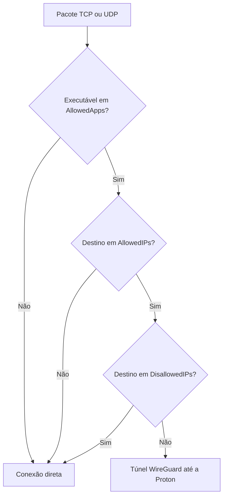
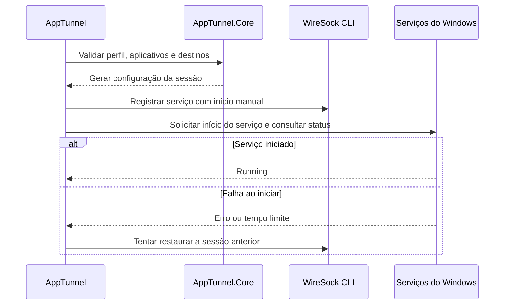

# AppTunnel


Use a **Proton VPN só nos aplicativos que você escolher**, como Serein, Discord ou outro cliente compatível. O AppTunnel permite selecionar os programas e a rota WireGuard pelo painel. O WireSock mantém a conexão como serviço do Windows e coloca o tráfego TCP e UDP dos programas escolhidos no túnel.

**Para começar, baixe o instalador x64 em [Releases](https://github.com/F404X/app-tunnel/releases).** O guia abaixo explica desde a instalação até o primeiro teste.

## Antes de instalar

- **Windows 10 ou 11 de 64 bits, arquitetura x64.** Para conferir, abra **Configurações → Sistema → Sobre** e procure **Tipo de sistema**.
- **Uma conta Proton.** Você pode criar uma conta gratuita e escolher um dos servidores disponíveis no seu plano. [Criar conta Proton VPN](https://protonvpn.com/free-vpn)
- **Permissão de administrador no Windows.** O sistema pede essa permissão porque o AppTunnel usa um serviço de rede.

## 1. Instale o AppTunnel

1. Abra [Releases](https://github.com/F404X/app-tunnel/releases). Em **Assets**, baixe **AppTunnel-Setup-x64.exe**.
2. Clique duas vezes no arquivo baixado. Confirme a permissão de administrador do Windows e siga as etapas do instalador.
3. Na última tela, mantenha marcadas as opções de instalar o **WireSock Secure Connect CLI** e o **Microsoft Edge WebView2 Runtime**, se aparecerem. O WireSock direciona o tráfego para a VPN. O WebView2 abre a página da Proton dentro do AppTunnel. Se o Windows pedir confirmação para instalar um deles, siga as instruções na tela.
4. Clique em **Concluir**. Para abrir o AppTunnel depois, pesquise **AppTunnel** no menu **Iniciar**.

O instalador inclui o .NET. Se você usava o ZIP da versão 0.4.0 ou anterior, feche primeiro a janela da Proton e escolha **Sair da interface** no menu da bandeja. Seus perfis e preferências continuam disponíveis ao abrir a versão instalada.

### Versão portátil

Em **Assets**, baixe **AppTunnel-Windows-x64.zip**, clique com o botão direito no arquivo e escolha **Extrair tudo**. Abra **AppTunnel.exe** de dentro da pasta extraída e mantenha todos os arquivos juntos. Em um PC sem WireSock ou WebView2, instale os componentes pelos links oficiais abaixo ou execute os comandos no PowerShell.

```powershell
winget install --id NTKERNEL.WireSockVPNClientCLI --exact --source winget
winget install --id Microsoft.EdgeWebView2Runtime --exact --source winget
```

O AppTunnel requer o WireSock CLI 3.8.2.1 ou superior. Se o Windows não reconhecer `winget`, use as páginas de download dos fabricantes ou instale o **Instalador de Aplicativo** da Microsoft Store. [WireSock](https://wiresock.net/wiresock-secure-connect/download) · [WebView2](https://developer.microsoft.com/microsoft-edge/webview2/) · [Ajuda do WinGet](https://learn.microsoft.com/pt-br/windows/package-manager/winget/)

## 2. Escolha o idioma

O aplicativo abre em inglês. Para mudar, clique em **Language → Português** no menu lateral. O seletor com bandeiras também oferece **English** e **Русский**. O restante do guia usa os nomes em português e inclui os termos principais em inglês.

## 3. Escolha o servidor da Proton

Um **perfil WireGuard** guarda o endereço do servidor e a chave necessária para conectar. Você pode reaproveitar um perfil da sua conta Proton, criar um pelo assistente ou importar um arquivo que já tenha guardado.

### Criar um perfil pelo AppTunnel

1. Abra **Rotas (Routes) → Perfis da conta (Account profiles)**. Se aparecer a janela de login da Proton, entre na sua conta e conclua a verificação solicitada. Volte ao AppTunnel e abra **Perfis da conta** novamente para ver o que já existe.
2. Se precisar de um perfil novo, clique em **Novo WireGuard… (New WireGuard…)**. Dê um nome fácil de reconhecer, como `AppTunnel casa`.
3. Clique em **Criar com servidor recomendado** para usar o servidor sugerido pela Proton. Para escolher a localização, clique em **Escolher outro servidor…** e depois em **Criar** ao lado do servidor na lista da Proton.
4. Aguarde com a janela aberta até o perfil aparecer em **Rotas**. A configuração é importada automaticamente quando a Proton a exibe completa. Clique na rota para selecioná-la.

Cada confirmação de criação adiciona um perfil persistente à sua conta Proton. Login, sincronização, conexão e troca de rota usam os perfis disponíveis. Se a criação ficar sem confirmação, confira **Perfis da conta** antes de tentar outra vez. Para revogar um perfil remoto, abra a conta na Proton.

Os perfis com uma chave utilizável são importados automaticamente. Se aparecer **Requer o .conf original**, importe o arquivo salvo na criação ou crie um novo perfil. A Proton usa uma chave privada gerada na criação do perfil. [Guia oficial da Proton](https://protonvpn.com/support/wireguard-configurations) · [Implementação da página de configuração](https://github.com/ProtonMail/WebClients/blob/main/packages/components/containers/vpn/WireGuardConfigurationSection/WireGuardConfigurationSection.tsx#L387-L404)

### Usar um arquivo `.conf` que você já tem

1. Abra **Rotas → Importar .conf (Import .conf)**.
2. Escolha o arquivo original baixado da Proton e clique em **Abrir**.
3. Clique na linha da rota importada. Se preferir gerar o arquivo no seu navegador, acesse [Downloads da conta Proton](https://account.protonvpn.com/downloads#wireguard-configuration) e use **Configuração WireGuard**.

Guarde os arquivos `.conf` em um local privado. Eles contêm a chave privada do perfil.

## 4. Selecione os aplicativos e conecte

1. Abra **Programas (Apps) → Explorar aplicativos comuns (Explore Common Apps)**. Marque os aplicativos detectados e clique em **Aplicar seleção**. O catálogo lista Discord, PTB, Canary, Serein, Telegram, Signal e outros clientes. Os cartões escurecidos ficam indisponíveis. Para programas portáteis, abra o executável e tente novamente ou use **Adicionar .exe**.
2. Confira as caixas da coluna **VPN**. Marque os programas que devem usar o túnel. Se o programa estiver fora da pasta padrão, use **Adicionar .exe (Add .exe)** ou **Em execução… (Running apps…)**. Ao usar **Adicionar pasta**, escolha a pasta do próprio aplicativo, pois a regra abrange os executáveis nela.
3. Volte a **Rotas** e clique no servidor desejado. No painel superior, clique em **Conectar (Connect)**.
4. Aguarde **Serviço VPN do WireSock em execução (WireSock VPN service is running)**. Se um Discord oficial, PTB ou Canary estiver aberto e incluído na rota, o AppTunnel pergunta se você quer reiniciá-lo. Escolha **Sim** para recriar a conexão de voz e vídeo ou **Não** para reiniciar o Discord depois. Com o Serein, você pode seguir direto para o teste da chamada ou da transmissão.

O painel superior mostra o **servidor em uso** e seu endereço. Para trocar, selecione outra linha em **Rotas** e clique em **Trocar servidor (Switch server)**. Se mudar os aplicativos ou os filtros durante a conexão, clique em **Aplicar ajustes (Apply settings)**.

## Como o AppTunnel funciona por dentro

O AppTunnel transforma um **perfil WireGuard da Proton**, uma lista de **executáveis ou pastas** e filtros de **destino IP** em uma configuração de sessão. A interface em C# prepara o arquivo e controla o serviço do Windows. O WireSock aplica as regras aos pacotes TCP e UDP e faz a comunicação WireGuard com o servidor da Proton. [Código que gera a configuração](src/AppTunnel.Core/WireGuardProfile.cs) · [Documentação do WireSock](https://wiresock.net/documentation/wiresock-secure-connect/advanced-parameters)

### Como o WireSock decide para onde vai cada pacote



| Regra | Como o AppTunnel a monta |
| --- | --- |
| `#@ws:AllowedApps` | Usa os caminhos completos dos executáveis e pastas marcados. Uma pasta inclui os executáveis dentro dela, inclusive em subpastas. |
| `AllowedIPs` | Parte das redes autorizadas pelo perfil. Cada IP ou faixa em **Pela VPN** precisa estar dentro de uma dessas redes. O IPv6 entra quando está habilitado e o perfil traz tanto endereço IPv6 quanto rota IPv6. |
| `#@ws:DisallowedIPs` | Inclui os IPs ou faixas em **Pela conexão direta**. Com a opção de rede local ativada, inclui também faixas predefinidas, como `192.168.0.0/16`. Essas exclusões se aplicam mesmo a executáveis marcados. |

Por exemplo, com o **Serein** marcado, o **navegador** desmarcado e a **rede local** configurada para sair direto, as mesmas regras produzem estes três resultados.

| Aplicativo | Destino de exemplo | Caminho |
| --- | --- | --- |
| Serein | IP público de um servidor de voz, dentro de `AllowedIPs` | Proton VPN |
| Navegador | O mesmo IP público | Conexão direta |
| Serein | `192.168.1.10`, dentro de uma faixa excluída | Conexão direta |

Estas são as linhas de roteamento da seção `[Peer]` nesse exemplo, com uma das faixas da rede local.

```ini
AllowedIPs = 0.0.0.0/0
#@ws:AllowedApps = C:\Users\Ana\AppData\Local\Programs\Serein\serein.exe
#@ws:DisallowedIPs = 192.168.0.0/16
```

No modo transparente padrão, o AppTunnel omite o campo `DNS` do perfil e deixa a resolução a cargo do Windows ou do próprio aplicativo. A opção **Usar DNS do perfil** ativa o redirecionamento de DNS do WireSock. As regras de destino usam IPs e redes CIDR. [Filtros na configuração](src/AppTunnel.Core/WireGuardProfile.cs) · [Parâmetros do WireSock](https://wiresock.net/documentation/wiresock-secure-connect/advanced-parameters)

### Da conta Proton ao arquivo de sessão

A janela de conta roda em `AppTunnel.Proton.exe`, um processo sem elevação que abre a página oficial em WebView2. Após o login, ela lista os perfis que a página exibe e importa as configurações completas. Ao confirmar a criação no assistente, o AppTunnel prepara e envia o formulário oficial com a sessão autenticada, e a página da Proton gera a chave e registra o perfil. O mesmo validador atende à sincronização e à importação manual, aceitando uma seção `[Interface]` e um único `[Peer]`, com chaves, endereços, destinos e endpoint válidos. Para AmneziaWG, o validador também confere os parâmetros de obfuscação da versão compatível. [Janela da Proton](src/AppTunnel.Proton/Program.cs) · [Assistente de criação](src/AppTunnel.Proton/AccountWindow.Creation.cs) · [Validador WireGuard](src/AppTunnel.Core/WireGuardProfile.cs)


O **DPAPI** também cifra os perfis transferidos localmente entre a janela da Proton e a interface. A cópia usada pelo WireSock recebe uma **ACL**, a lista de permissões de acesso do Windows. O registro `HKLM\SOFTWARE\AppTunnel` guarda os metadados da sessão, incluindo o SID do proprietário e os caminhos do WireSock e do arquivo de configuração. Ao reabrir, o AppTunnel confere esses dados com o serviço do Windows para recuperar a rota ativa. [Armazenamento do perfil](src/AppTunnel.Windows/ProfileStore.cs) · [Controle do serviço](src/AppTunnel.Windows/WireSockEngine.cs) · [DPAPI no Windows](https://learn.microsoft.com/en-us/windows/win32/api/dpapi/nf-dpapi-cryptprotectdata)

### O que ocorre ao conectar e trocar de rota



- **Aplicar ajustes** e **Trocar servidor** substituem a configuração e reiniciam o serviço. Se a nova sessão falhar, o AppTunnel tenta restaurar a anterior. O indicador **Serviço VPN do WireSock em execução** vem do estado `Running` do serviço. Para validar o caminho de ponta a ponta, gere tráfego em um aplicativo marcado. [Controle do serviço](src/AppTunnel.Windows/WireSockEngine.cs)
- **Discord, PTB e Canary** recebem a opção de reiniciar quando estão abertos e pertencem à rota aplicada. O reinício recria as conexões já abertas. O Serein fica fora desse fluxo. [Regras de reinício](src/AppTunnel.Windows/DiscordRestart.cs) · [Aplicação da rota](src/AppTunnel.Windows/MainForm.cs)
- **Sair da interface** fecha o processo da bandeja. O serviço do WireSock continua ativo como processo independente. **Iniciar com o Windows** registra uma tarefa por usuário que abre a interface na bandeja ao fazer login. [Bandeja](src/AppTunnel.Windows/AppTunnelApplicationContext.cs) · [Inicialização do Windows](src/AppTunnel.Windows/WindowsStartup.cs)

## Redes com filtragem e DPI

Selecione uma opção em **Rotas → Protocolo VPN**. Depois de mudar a opção, clique em **Conectar** ou **Aplicar ajustes**.

| Opção | Motor e requisitos |
| --- | --- |
| **Do perfil** | Usa o protocolo do arquivo selecionado. Para perfis `.conf` da Proton, é WireGuard. |
| **WireGuard** | Usa UDP com o WireSock e um perfil WireGuard compatível. |
| **WireGuard com preenchimento** | Usa o preenchimento pré-handshake do WireSock, compatível com servidores WireGuard comuns. Pode ser selecionado com um `.conf` da Proton. |
| **AmneziaWG** | Importe um `.conf` de um servidor AmneziaWG compatível. O AppTunnel aceita a configuração com `S1`, `S2` e `H1` a `H4` como valores inteiros. Os parâmetros devem corresponder aos do servidor. |
| **Automático** | Começa pelo perfil selecionado e tenta até quatro combinações de protocolo e endpoint. Usa apenas os perfis importados e, quando compatível, tenta WireGuard com preenchimento no mesmo endpoint. |

No modo **Automático**, importe mais de um perfil para permitir a troca de servidor. Com a interface aberta ou recolhida na bandeja, uma falha posterior identificada nos registros pode iniciar uma rodada de recuperação com as alternativas disponíveis. O split tunneling, os filtros e as opções de privacidade continuam sendo aplicados em cada tentativa. A troca pode interromper chamadas ou transmissões.

**Diagnóstico** separa resposta de handshake, ausência de resposta após o envio, erro de endpoint e erro de rota ou adaptador. O AppTunnel usa eventos recentes do WireSock. Quando os registros não expõem esses eventos, o painel mostra **status do handshake indisponível**. Uma ausência de resposta também pode indicar servidor indisponível ou chaves incompatíveis.

O Proton Stealth está disponível nos clientes oficiais da Proton. Os arquivos manuais fornecidos pela Proton usam WireGuard. O AppTunnel usa esses arquivos no WireSock. WireGuard com preenchimento e AmneziaWG também dependem de UDP, e a eficácia varia conforme a rede. [Protocolos da Proton](https://protonvpn.com/support/how-to-change-vpn-protocols) · [Configuração manual da Proton](https://protonvpn.com/support/wireguard-manual-windows) · [Parâmetros do WireSock](https://wiresock.net/documentation/wiresock-secure-connect/advanced-parameters)

### DNS e IPv6 com split tunneling

- **Usar DNS do perfil (resolvedor compartilhado)** envia as consultas do resolvedor compartilhado do Windows ao DNS do perfil pelo WireSock. A opção exige DNS dentro dos destinos da VPN e pode afetar nomes locais e consultas de outros aplicativos que usam o resolvedor do Windows. Aplicativos com DNS próprio, como DoH, seguem suas próprias configurações e as regras de tráfego.
- **Bloquear IPv6 público sem rota IPv6** aplica regras de saída no Firewall do Windows para os executáveis marcados quando a sessão fica sem rota IPv6 no túnel. Bloqueia `2000::/3` e exige regras de executáveis individuais em vez de pastas. A desconexão remove as regras criadas pela sessão. Use **Incluir IPv6 quando disponível** para usar as rotas autorizadas por perfis dual-stack.
- Os destinos excluídos seguem pela conexão direta. A troca de servidor substitui o serviço e pode abrir um intervalo entre sessões. Essas opções reduzem os caminhos de vazamento descritos acima e têm escopo diferente de um kill switch.

[DNS e rede local no WireSock](https://wiresock.net/documentation/guide/local-resources-unavailable.html) · [Configuração de rotas](src/AppTunnel.Core/WireGuardProfile.cs) · [Regras IPv6](src/AppTunnel.Windows/Ipv6Firewall.cs)

## Bandeja e desconexão

| O que você quer fazer | Onde clicar |
| --- | --- |
| Recolher a janela e continuar conectado | Feche a janela pelo **X**. O AppTunnel fica na bandeja do Windows, perto do relógio. Procure na seta de ícones ocultos se necessário. |
| Esconder o ícone do AppTunnel | Clique com o botão direito nele e escolha **Ocultar ícone (Hide Tray)**. |
| Restaurar a janela e o ícone | Abra `AppTunnel.exe` novamente. A instância existente é trazida de volta. |
| Encerrar a interface e manter o serviço | Na bandeja, escolha **Sair da interface (Exit interface)**. |
| Abrir o AppTunnel com o Windows | Marque **Iniciar com o Windows (Start with Windows)** em **Configurações (Settings)** ou no menu de contexto do ícone da bandeja. A opção está disponível na versão instalada. |
| Parar a VPN | Clique em **Desconectar (Disconnect)** no painel ou **Desconectar VPN (Disconnect VPN)** na bandeja. |

Com **Iniciar com o Windows** ativado, o AppTunnel abre na bandeja quando você entra na sua conta do Windows. Para ligar a VPN após reiniciar o PC, abra o AppTunnel e clique em **Conectar**.

## Aparência e privacidade

Em **Configurações → Aparência**, o tema padrão acompanha a preferência de cores do Windows. Também há opções de tema **Claro** e **Escuro**.

O instalador e **Configurações → Privacidade e feedback** oferecem **Enviar estatísticas anônimas**, **Relatórios automáticos de erros** e **Incluir diagnósticos detalhados**. Cada opção começa desmarcada. Use **Visualizar dados enviados** para conferir os campos, as prévias e o histórico local. O envio de cada relatório de diagnóstico exige autorização própria. [Política de privacidade](docs/PRIVACY.md) · [Infraestrutura e testes](telemetry/README.md)

## Atualizar o AppTunnel

Abra **Configurações (Settings) → Verificar atualizações (Check for updates)**. Se houver uma versão mais recente com instalador no GitHub, o AppTunnel baixa e verifica o arquivo, incluindo versões de prévia. Confirme quando aparecer a opção de instalar e siga o assistente. A atualização preserva perfis, preferências e o serviço da VPN em execução.

Na edição instalada, **Atualizar automaticamente**, logo abaixo de **Iniciar com o Windows**, verifica uma vez por dia e instala a atualização verificada em segundo plano. O app volta para a bandeja com as preferências existentes.

Se estiver na versão 0.4.0 ou anterior, baixe o instalador pela página de [Releases](https://github.com/F404X/app-tunnel/releases).

## Se algo der errado

| O que aparece | Como resolver |
| --- | --- |
| O executável pede o .NET | Baixe o instalador atual em Releases. Se preferir continuar com um ZIP antigo, instale o [.NET Desktop Runtime 10 x64](https://dotnet.microsoft.com/en-us/download/dotnet/10.0). |
| A janela Proton fica indisponível | Instale ou atualize o **WebView2 Runtime**. Você também pode baixar o perfil pela página oficial da Proton e usar **Importar .conf**. |
| O assistente não confirma a criação | Confira **Rotas → Perfis da conta** antes de repetir. Se o formulário integrado estiver indisponível, use a página da Proton e importe o `.conf`. |
| O WireSock aparece como ausente | Instale o pacote **WireSock Secure Connect CLI** pela página oficial ou pelo comando acima. Em **Diagnóstico (Diagnostics)**, use **Detectar novamente (Detect again)**. Se ainda precisar indicar o caminho manualmente, use **Localizar WireSock… (Locate WireSock…)** e procure `wiresock-client.exe`, normalmente em `C:\Program Files\WireSock Secure Connect\sdk\`. |
| A importação diz que `PrivateKey` está vazia ou inválida | Use o `.conf` original que contém a chave privada ou gere um novo perfil na Proton. |
| O servidor aparece em uso e a chamada continua falhando | Confira se marcou o executável certo em **Programas**, aplique as alterações, feche o cliente de chat por completo e reabra. Se necessário, teste outro servidor e confira os registros em **Diagnóstico**. |
| Outro serviço WireSock já está em uso | Desconecte a sessão no aplicativo que a iniciou e tente conectar pelo AppTunnel. |

Para enviar um problema, abra uma [issue](https://github.com/F404X/app-tunnel/issues/new) com a versão do AppTunnel, a versão do Windows e os passos para reproduzir. Copie a mensagem de erro ou os registros relevantes de **Diagnóstico**. Mantenha as chaves privadas e os arquivos `.conf` fora do relato.

## Compilar e testar

Para compilar no Windows, instale o **SDK .NET 10** e execute na raiz do repositório. O resultado fica em `dist/win-x64`.

```powershell
.\Compilar.ps1
dotnet run --project tests/AppTunnel.Checks -c Release
node tests/proton-portal.test.cjs
node --test tests/telemetry.test.mjs
```

Use `./Compilar.ps1 -SelfContained` para incluir o .NET no pacote. O arquivo `installer/AppTunnel.iss` gera o instalador com o Inno Setup 6.3 ou superior. O workflow **Build and publish Windows release** valida o instalador e testa instalação, atualização e remoção no Windows após mudanças no código da branch `main`. Para publicar, marque **Publish GitHub release** na execução manual ou envie à `main` um commit com a mensagem exata `Release AppTunnel vX.Y.Z` e a versão correspondente em `Directory.Build.props`. Publicações por commit saem como prévia. O build distribui somente os recursos de idioma usados pela interface.

| Projeto | Responsabilidade |
| --- | --- |
| `src/AppTunnel.Windows` | Interface, catálogo de aplicativos, bandeja e contrato `ITunnelEngine`. O adaptador WireSock é o motor distribuído nesta implementação. |
| `src/AppTunnel.Core` | Validação de perfis, planejamento das tentativas, classificação de diagnósticos e integração Proton. |
| `src/AppTunnel.Proton` | Janela de conta Proton e importação dos perfis disponíveis. |

O código usa a [licença MIT](LICENSE). Os termos de uso podem ser consultados no instalador, em **Configurações → Termos de uso** e neste repositório. [Português](docs/terms/pt.txt) · [English](docs/terms/en.txt) · [Русский](docs/terms/ru.txt)

As licenças das dependências e fontes incluídas acompanham seus arquivos em [Licenses](Licenses) e [Fonts](src/AppTunnel.Windows/Fonts). A paleta da interface é a [Meia-noite do Cartigma beta](https://github.com/F404X/cartigma/blob/feature/ranking/themes.css).
