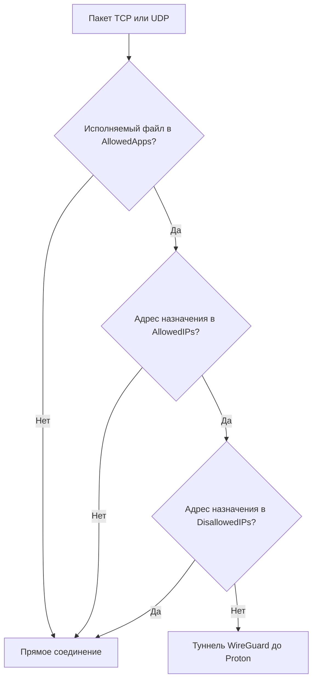
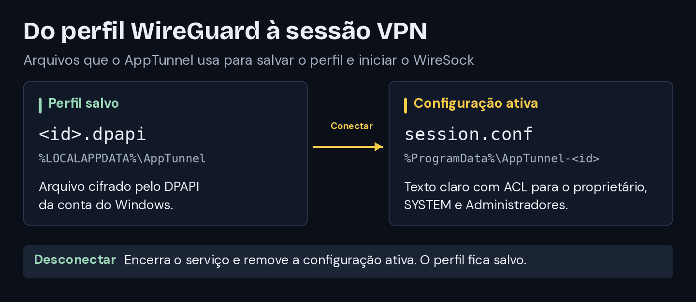
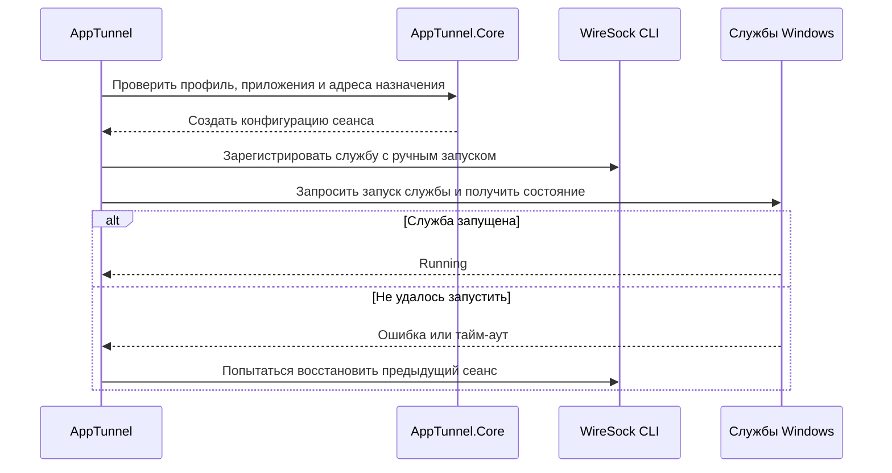

# AppTunnel

[English](README.md) · [Português](README.pt-BR.md) · **Русский**


Используйте **Proton VPN только в выбранных приложениях**, например в Serein, Discord или другом совместимом клиенте. В окне AppTunnel вы выбираете программы и маршрут WireGuard. WireSock работает как служба Windows и направляет в туннель TCP- и UDP-трафик выбранных программ.

**Чтобы начать, скачайте установщик x64 в разделе [Releases](https://github.com/F404X/app-tunnel/releases).** В руководстве ниже описаны все шаги от установки до первой проверки.

## Перед установкой

- **64-разрядная Windows 10 или 11 (x64).** Чтобы проверить, откройте **Параметры → Система → О системе** и найдите **Тип системы**.
- **Учётная запись Proton.** Можно создать бесплатную учётную запись и выбрать любой сервер из доступных на вашем тарифе. [Создать учётную запись Proton VPN](https://protonvpn.com/free-vpn)
- **Права администратора Windows.** Windows запрашивает их, потому что AppTunnel использует сетевую службу.

## 1. Установите AppTunnel

1. Откройте [Releases](https://github.com/F404X/app-tunnel/releases). В разделе **Assets** скачайте **AppTunnel-Setup-x64.exe**.
2. Дважды щёлкните скачанный файл. Подтвердите запрос Windows на права администратора и следуйте шагам установщика.
3. На последней странице оставьте отмеченными установку **WireSock Secure Connect CLI** и **Microsoft Edge WebView2 Runtime**, если они появятся. WireSock направляет трафик в VPN, а WebView2 открывает страницу Proton внутри AppTunnel. Если Windows попросит подтвердить установку одного из компонентов, следуйте указаниям на экране.
4. Нажмите **Готово**. Чтобы позже открыть AppTunnel, найдите **AppTunnel** в меню **Пуск**.

Установщик включает .NET. Если вы пользовались ZIP-версией 0.4.0 или старше, сначала закройте окно Proton и выберите **Закрыть интерфейс** в меню трея. Ваши профили и настройки останутся доступны после запуска установленной версии.

### Портативная версия

В разделе **Assets** скачайте **AppTunnel-Windows-x64.zip**, щёлкните файл правой кнопкой мыши и выберите **Извлечь всё**. Откройте **AppTunnel.exe** из извлечённой папки и храните все файлы вместе. Если на компьютере нет WireSock или WebView2, установите их по официальным ссылкам ниже или выполните команды в PowerShell.

```powershell
winget install --id NTKERNEL.WireSockVPNClientCLI --exact --source winget
winget install --id Microsoft.EdgeWebView2Runtime --exact --source winget
```

AppTunnel требует WireSock CLI версии 3.8.2.1 или новее. Если Windows не распознаёт `winget`, воспользуйтесь страницами загрузки разработчиков или установите **Установщик приложений** из Microsoft Store. [WireSock](https://wiresock.net/wiresock-secure-connect/download) · [WebView2](https://developer.microsoft.com/microsoft-edge/webview2/) · [Справка по WinGet](https://learn.microsoft.com/ru-ru/windows/package-manager/winget/)

## 2. Выберите язык

При первом запуске приложение использует язык Windows, если это русский, английский или португальский, а в остальных случаях английский. Чтобы изменить язык, нажмите **Язык** в боковом меню. В списке с флагами также есть **English**, **Português** и **Русский**.

## 3. Выберите сервер Proton

**Профиль WireGuard** хранит адрес сервера и ключ, необходимый для подключения. Вы можете использовать профиль из своей учётной записи Proton, создать новый с помощью мастера или импортировать сохранённый файл. Добавьте как минимум два разных сервера, чтобы работало автоматическое переключение. Для подключения достаточно одного сервера.

При первом запуске **мастер настройки** проверяет WireSock и WebView2, открывает вход в Proton и спрашивает, какие приложения должны работать через VPN. Когда он закончит, нажмите **Подключиться**. Чтобы запустить мастер снова, выберите **Настройки → Запустить первоначальную настройку**.

### Выбор маршрута без открытия браузера

1. Откройте **Серверы → Выбрать маршрут**. AppTunnel покажет серверы, доступные вашей учётной записи Proton, с указанием страны, города, нагрузки и пинга. Бесплатные учётные записи видят только бесплатные серверы.
2. Нажмите на сервер. AppTunnel создаст конфигурацию WireGuard в вашей учётной записи Proton и через несколько секунд сохранит её в разделе **Серверы**.

Список и создание используют сеанс Proton, уже сохранённый в AppTunnel, и работают в фоне, без открытия окна. AppTunnel никогда не получает ваш пароль. Если сеанс истёк, один раз откроется окно входа Proton: войдите и снова выберите маршрут. Ключ создаётся на вашем компьютере и сохраняется до отправки запроса в Proton, поэтому созданный маршрут никогда не остаётся без ключа, даже если соединение прервётся на полпути.

### Создание профиля в окне Proton

1. Откройте **Серверы → Другие варианты → Профили учётной записи Proton…**. Если появится окно входа Proton, войдите в учётную запись и пройдите запрошенную проверку. Вернитесь в AppTunnel и снова откройте **Профили учётной записи Proton…**, чтобы увидеть уже существующие профили.
2. Если нужен новый профиль, выберите **Другие варианты → Создать в окне Proton…**. Дайте ему понятное имя, например `AppTunnel дом`.
3. Нажмите **Создать с рекомендованным сервером**, чтобы использовать сервер, предложенный Proton. Чтобы выбрать расположение, нажмите **Выбрать другой сервер…**, а затем **Создать** рядом с сервером в списке Proton.
4. Не закрывайте окно, пока профиль не появится в разделе **Серверы**. Конфигурация импортируется автоматически, когда Proton показывает её полностью.

Каждое подтверждённое создание добавляет в вашу учётную запись Proton постоянный профиль. Вход, синхронизация, подключение и смена маршрута используют доступные профили. Если создание осталось без подтверждения, проверьте **Профили учётной записи Proton…**, прежде чем повторять попытку. Чтобы отозвать удалённый профиль, откройте свою учётную запись на сайте Proton.

Профили с пригодным к использованию ключом импортируются автоматически. Если появится **Нужен исходный файл .conf**, импортируйте файл, сохранённый при создании, или создайте новый профиль. Proton использует закрытый ключ, созданный при создании профиля. [Официальное руководство Proton](https://protonvpn.com/support/wireguard-configurations) · [Реализация страницы конфигурации](https://github.com/ProtonMail/WebClients/blob/main/packages/components/containers/vpn/WireGuardConfigurationSection/WireGuardConfigurationSection.tsx#L387-L404)

### Использование уже имеющегося файла `.conf`

1. Откройте **Серверы → Другие варианты → Импортировать файл .conf…**.
2. Выберите исходный файл, скачанный из Proton, и нажмите **Открыть**.
3. Импортированный сервер появится в списке. Если вы предпочитаете создать файл в браузере, откройте [Загрузки учётной записи Proton](https://account.protonvpn.com/downloads#wireguard-configuration) и выберите **Конфигурация WireGuard**.

Храните файлы `.conf` в закрытом месте. В них находится закрытый ключ профиля.

## 4. Выберите приложения и подключитесь

1. Откройте **Приложения → Добавить приложение → Часто используемые приложения…**. Отметьте найденные приложения и нажмите **Применить выбор**. В каталоге есть Discord, PTB, Canary, Serein, Telegram, Signal и другие клиенты. Затемнённые карточки недоступны. Для портативных программ используйте **Выбрать файл .exe…**, **Из запущенных…** или перетащите `.exe`, ярлык или папку в область, обведённую пунктиром.
2. Включите переключатель у каждого приложения, которое должно работать через туннель. Подпись показывает **Через VPN** или **Напрямую**. Чтобы удалить приложение, нажмите **×** в его строке. При выборе **Папка целиком…** указывайте папку самого приложения, потому что правило охватывает исполняемые файлы внутри неё.
3. В разделе **Серверы** оставьте **Автоматически**, чтобы использовать самый быстрый сервер, или закрепите сервер из списка.
4. На странице **Главная** нажмите круглую кнопку и дождитесь состояния **Подключено · Защищено**. Если официальный Discord, PTB или Canary открыт и входит в маршрут, AppTunnel спросит, нужно ли его перезапустить. Выберите **Перезапустить**, чтобы пересоздать голосовое и видеосоединение, или **Не сейчас**, чтобы перезапустить Discord позже. Отметьте **Запомнить выбор**, чтобы вопрос больше не появлялся. Изменить выбор можно в **Настройки → Подключение**. С Serein можно сразу переходить к проверке звонка или трансляции.

Карточка **Сервер** на странице **Главная** показывает используемый сервер, а карточка **Подключение** — подтверждено ли рукопожатие. Кнопка **Проверить** измеряет пинг до сервера. Чтобы закрепить другой сервер во время подключения, выберите строку в разделе **Серверы** и нажмите **Сменить сервер** на странице **Главная**. В режиме **Автоматически** AppTunnel выбирает самый быстрый сервер при подключении и сам переключается, когда текущий становится медленным или отказывает. Если вы меняете приложения, протокол или фильтры во время подключения, AppTunnel применяет изменения сам примерно через 1,5 секунды после последней правки, а уведомление внизу предлагает **Отменить**. Поля IP применяются, когда вы покидаете поле. Чтобы применять вручную кнопкой **Применить изменения**, снимите флажок **Автоматически применять изменения при подключении** в **Настройки → Подключение**. Задержка каждого сервера обновляется автоматически при открытии AppTunnel и страницы **Серверы**, не чаще раза в минуту.

## Как AppTunnel устроен внутри

AppTunnel превращает **профиль WireGuard от Proton**, список **исполняемых файлов или папок** и фильтры **IP-адресов назначения** в конфигурацию сеанса. Интерфейс на C# готовит файл и управляет службой Windows. WireSock применяет правила к пакетам TCP и UDP и обменивается данными по WireGuard с сервером Proton. [Код, создающий конфигурацию](https://github.com/F404X/app-tunnel/blob/main/src/AppTunnel.Core/WireGuardProfile.cs) · [Документация WireSock](https://wiresock.net/documentation/wiresock-secure-connect/advanced-parameters)

### Как WireSock решает, куда отправить каждый пакет



| Правило | Как AppTunnel его формирует |
| --- | --- |
| `#@ws:AllowedApps` | Использует полные пути отмеченных исполняемых файлов и папок. Папка включает исполняемые файлы внутри неё, в том числе во вложенных папках. |
| `AllowedIPs` | Берёт за основу сети, разрешённые профилем. Каждый IP-адрес или диапазон в списке **Через VPN** должен входить в одну из них. IPv6 включается, если он разрешён и в профиле есть и адрес IPv6, и маршрут IPv6. |
| `#@ws:DisallowedIPs` | Содержит IP-адреса или диапазоны, которые идут по прямому соединению. Если включена опция локальной сети, добавляются также заранее заданные диапазоны, например `192.168.0.0/16`. Эти исключения действуют даже для отмеченных исполняемых файлов. |

Например, если отметить **Serein**, не отмечать **браузер** и настроить выход **локальной сети** напрямую, те же правила дают три результата.

| Приложение | Пример адреса назначения | Путь |
| --- | --- | --- |
| Serein | Публичный IP голосового сервера, входящий в `AllowedIPs` | Proton VPN |
| Браузер | Тот же публичный IP | Прямое соединение |
| Serein | `192.168.1.10`, входящий в исключённый диапазон | Прямое соединение |

Вот строки маршрутизации секции `[Peer]` в этом примере с одним из диапазонов локальной сети.

```ini
AllowedIPs = 0.0.0.0/0
#@ws:AllowedApps = C:\Users\Ana\AppData\Local\Programs\Serein\serein.exe
#@ws:DisallowedIPs = 192.168.0.0/16
```

В прозрачном режиме по умолчанию AppTunnel не передаёт поле `DNS` профиля и оставляет разрешение имён Windows или самому приложению. Опция **DNS из профиля** включает перенаправление DNS в WireSock. Правила назначения используют IP-адреса и сети CIDR. [Фильтры в конфигурации](https://github.com/F404X/app-tunnel/blob/main/src/AppTunnel.Core/WireGuardProfile.cs) · [Параметры WireSock](https://wiresock.net/documentation/wiresock-secure-connect/advanced-parameters)

### От учётной записи Proton до файла сеанса

Окно учётной записи работает в `AppTunnel.Proton.exe` — процессе без повышенных прав, который открывает официальную страницу в WebView2. После входа оно перечисляет профили, показанные на странице, и импортирует полные конфигурации. Когда вы подтверждаете создание в мастере, AppTunnel готовит и отправляет официальную форму с проверенным сеансом, а страница Proton создаёт ключ и регистрирует профиль. Один и тот же валидатор обслуживает синхронизацию и ручной импорт: он принимает секцию `[Interface]` и один `[Peer]` с корректными ключами, адресами, назначениями и точкой подключения. Для AmneziaWG валидатор также проверяет параметры обфускации поддерживаемой версии. [Окно Proton](https://github.com/F404X/app-tunnel/blob/main/src/AppTunnel.Proton/Program.cs) · [Мастер создания](https://github.com/F404X/app-tunnel/blob/main/src/AppTunnel.Proton/AccountWindow.Creation.cs) · [Валидатор WireGuard](https://github.com/F404X/app-tunnel/blob/main/src/AppTunnel.Core/WireGuardProfile.cs)



**DPAPI** также шифрует профили, передаваемые локально между окном Proton и интерфейсом. Копия, которую использует WireSock, получает **ACL** — список прав доступа Windows. Раздел реестра `HKLM\SOFTWARE\AppTunnel` хранит метаданные сеанса, в том числе SID владельца и пути к WireSock и файлу конфигурации. При повторном открытии AppTunnel сверяет эти данные со службой Windows, чтобы восстановить активный маршрут. [Хранение профиля](https://github.com/F404X/app-tunnel/blob/main/src/AppTunnel.Windows/ProfileStore.cs) · [Управление службой](https://github.com/F404X/app-tunnel/blob/main/src/AppTunnel.Windows/WireSockEngine.cs) · [DPAPI в Windows](https://learn.microsoft.com/en-us/windows/win32/api/dpapi/nf-dpapi-cryptprotectdata)

### Что происходит при подключении и смене маршрута



- Автоматическое применение, **Применить изменения** и **Сменить сервер** заменяют конфигурацию и перезапускают службу. Если новый сеанс не запустился, AppTunnel пытается восстановить предыдущий и показывает **Применить изменения**, чтобы вы могли повторить. Индикатор **Подключено · Защищено** основан на состоянии службы `Running`. Чтобы проверить путь от начала до конца, создайте трафик в отмеченном приложении. [Управление службой](https://github.com/F404X/app-tunnel/blob/main/src/AppTunnel.Windows/WireSockEngine.cs)
- **Discord, PTB и Canary** получают предложение перезапуститься, если они открыты и только что вошли в маршрут или если сервер изменился. Клиенты, которые уже были в предыдущем сеансе на том же сервере, не перезапускаются. Перезапуск пересоздаёт уже открытые соединения. Serein в этот процесс не входит. [Правила перезапуска](https://github.com/F404X/app-tunnel/blob/main/src/AppTunnel.Windows/DiscordRestart.cs) · [Применение маршрута](https://github.com/F404X/app-tunnel/blob/main/src/AppTunnel.Windows/MainForm.cs)
- **Закрыть интерфейс** закрывает процесс в трее. Служба WireSock продолжает работать как независимый процесс. **Запускать вместе с Windows** регистрирует задачу для пользователя, которая открывает интерфейс в трее при входе в систему. [Трей](https://github.com/F404X/app-tunnel/blob/main/src/AppTunnel.Windows/AppTunnelApplicationContext.cs) · [Автозапуск Windows](https://github.com/F404X/app-tunnel/blob/main/src/AppTunnel.Windows/WindowsStartup.cs)

## Сети с фильтрацией и DPI

Выберите вариант в **Серверы → Дополнительно → Протокол**. После изменения нажмите **Подключить**. Если VPN уже подключён, изменение применяется автоматически.

| Вариант | Движок и требования |
| --- | --- |
| **Из профиля** | Использует протокол выбранного файла. Для профилей `.conf` от Proton это WireGuard. |
| **WireGuard** | Использует UDP через WireSock и совместимый профиль WireGuard. |
| **WireGuard с дополнением пакетов** | Использует дополнение пакетов WireSock до рукопожатия, совместимое с обычными серверами WireGuard. Его можно выбрать с `.conf` от Proton. |
| **AmneziaWG** | Импортируйте `.conf` совместимого сервера AmneziaWG. AppTunnel принимает конфигурацию с `S1`, `S2` и `H1`–`H4` в виде целых чисел. Параметры должны совпадать с параметрами сервера. |
| **Автоматически** | Начинает с выбранного профиля и пробует до четырёх сочетаний протокола и точки подключения. Использует только импортированные профили и, если это возможно, пробует WireGuard с дополнением на той же точке подключения. |

В режиме **Автоматически** импортируйте больше одного профиля, чтобы работала смена сервера. Когда интерфейс открыт или свёрнут в трей, более поздний сбой, замеченный в журналах, может запустить цикл восстановления с доступными альтернативами. Раздельное туннелирование, фильтры и параметры приватности продолжают применяться при каждой попытке. Переключение может прервать звонки или трансляции.

Если ответы на пинг по используемому маршруту остаются выше **400 мс не менее пяти секунд**, AppTunnel в фоне измеряет остальные совместимые серверы. Если есть более быстрая альтернатива, а текущий маршрут остаётся медленным, он переключается через WireSock. Замеры не затрагивают активное соединение. Само переключение может ненадолго прервать звонок или трансляцию, потому что служба загружает новый профиль. Новый маршрут сохраняется, только если WireSock записал ответ на рукопожатие. Без этого подтверждения AppTunnel возвращает предыдущий маршрут.

**Диагностика** различает ответ на рукопожатие, отсутствие ответа после отправки, ошибку точки подключения и ошибку маршрута или адаптера. AppTunnel использует недавние события WireSock. Если журналы не содержат этих событий, на панели отображается **статус рукопожатия недоступен**. Отсутствие ответа может также означать, что сервер недоступен или ключи не совпадают.

Proton Stealth доступен в официальных клиентах Proton. Файлы для ручной настройки, которые предоставляет Proton, используют WireGuard. AppTunnel использует эти файлы в WireSock. WireGuard с дополнением и AmneziaWG тоже зависят от UDP, а их эффективность зависит от сети. [Протоколы Proton](https://protonvpn.com/support/how-to-change-vpn-protocols) · [Ручная настройка Proton](https://protonvpn.com/support/wireguard-manual-windows) · [Параметры WireSock](https://wiresock.net/documentation/wiresock-secure-connect/advanced-parameters)

### DNS и IPv6 при раздельном туннелировании

Параметры ниже находятся в **Серверы → Дополнительно**. Раздел открывается свёрнутым, чтобы оставить больше места под список серверов, и раскрывается сам, если в **Всегда через VPN** или **Никогда через VPN** есть заполненные адреса.

- **DNS из профиля (общий преобразователь)** отправляет запросы общего преобразователя имён Windows на DNS профиля через WireSock. Для этой опции DNS должен входить в адреса, идущие через VPN. Она может повлиять на локальные имена и на запросы других приложений, использующих преобразователь Windows. Приложения со своим DNS, например с DoH, следуют своим настройкам и правилам трафика.
- **Блокировать IPv6 без маршрута (против утечек)** применяет исходящие правила брандмауэра Windows к отмеченным исполняемым файлам, когда в сеансе нет маршрута IPv6 в туннеле. Блокируется `2000::/3`, и для этого нужны правила для отдельных исполняемых файлов, а не для папок. При отключении правила, созданные сеансом, удаляются. Если служба WireSock остановится сама, AppTunnel также удалит службу, файлы сеанса и эти правила. Опция **Использовать IPv6 при наличии** позволяет использовать маршруты, разрешённые профилями с двумя стеками.
- Исключённые адреса идут по прямому соединению. Смена сервера заменяет службу и может создать разрыв между сеансами. Эти опции сокращают описанные выше пути утечки, но по охвату отличаются от kill switch.

[DNS и локальная сеть в WireSock](https://wiresock.net/documentation/guide/local-resources-unavailable.html) · [Настройка маршрутов](https://github.com/F404X/app-tunnel/blob/main/src/AppTunnel.Core/WireGuardProfile.cs) · [Правила IPv6](https://github.com/F404X/app-tunnel/blob/main/src/AppTunnel.Windows/Ipv6Firewall.cs)

## Трей и отключение

| Что вы хотите сделать | Куда нажать |
| --- | --- |
| Свернуть окно и остаться подключённым | Закройте окно кнопкой **X**. AppTunnel остаётся в трее Windows рядом с часами. При необходимости посмотрите стрелку скрытых значков. |
| Скрыть значок AppTunnel | Щёлкните его правой кнопкой мыши и выберите **Скрыть значок в трее**. |
| Вернуть окно и значок | Снова откройте `AppTunnel.exe`. Существующий экземпляр вернётся на экран. |
| Закрыть интерфейс и оставить службу | В трее выберите **Закрыть интерфейс**. |
| Открывать AppTunnel вместе с Windows | Отметьте **Запускать вместе с Windows** в **Настройки** или в контекстном меню значка в трее. Опция доступна в установленной версии. |
| Остановить VPN | Нажмите **Отключить** на панели или **Отключить VPN** в трее. |

Если включён **Запускать вместе с Windows**, AppTunnel открывается в трее при входе в учётную запись Windows. Чтобы включить VPN после перезагрузки, откройте AppTunnel и нажмите **Подключить**.

## Оформление

В **Настройки → Оформление** тема по умолчанию следует цветовым предпочтениям Windows. Также доступны **Светлая** и **Тёмная** темы.

## Обновление AppTunnel

Откройте **Настройки → Проверить обновления**. Если на GitHub есть более новая версия с установщиком, AppTunnel скачивает и проверяет файл, в том числе предварительные версии. Подтвердите установку, когда появится такая возможность, и следуйте мастеру. Обновление сохраняет профили, настройки и работающую службу VPN.

При отключённом VPN выберите **Настройки → Обновить WireSock**. AppTunnel использует WinGet из Windows, чтобы проверять и устанавливать обновления пакета WireSock CLI.

В установленной версии параметр **Автоматически обновлять** под пунктом **Запускать вместе с Windows** проверяет обновления раз в день и устанавливает проверенную версию в фоне. После этого приложение возвращается в трей с прежними настройками.

Если у вас версия 0.4.0 или старше, скачайте установщик на странице [Releases](https://github.com/F404X/app-tunnel/releases).

## Если что-то пошло не так

| Что вы видите | Как исправить |
| --- | --- |
| Исполняемый файл требует .NET | Скачайте актуальный установщик в Releases. Если хотите продолжать пользоваться старым ZIP, установите [.NET Desktop Runtime 10 x64](https://dotnet.microsoft.com/en-us/download/dotnet/10.0). |
| Окно Proton недоступно | Установите или обновите **WebView2 Runtime**. Можно также скачать профиль на официальной странице Proton и воспользоваться **Импортировать файл .conf…**. |
| Мастер не подтверждает создание | Проверьте **Серверы → Другие варианты → Профили учётной записи Proton…**, прежде чем повторять. Если встроенная форма недоступна, воспользуйтесь страницей Proton и импортируйте `.conf`. |
| WireSock отображается как отсутствующий | Установите пакет **WireSock Secure Connect CLI** с официальной страницы или командой выше. В **Диагностика** нажмите **Повторить поиск**. Если путь всё равно нужно указать вручную, выберите **Найти WireSock…** и найдите `wiresock-client.exe`, обычно в `C:\Program Files\WireSock Secure Connect\sdk\`. |
| При импорте сообщается, что `PrivateKey` пуст или недействителен | Используйте исходный `.conf`, содержащий закрытый ключ, или создайте новый профиль в Proton. |
| Сервер отображается как используемый, а звонок по-прежнему не работает | Убедитесь, что в **Приложения** включён нужный исполняемый файл, примените изменения, полностью закройте клиент чата и откройте его снова. При необходимости попробуйте другой сервер и посмотрите журналы в **Диагностика**. |
| Другая служба WireSock уже используется | Отключите сеанс в приложении, которое его запустило, и попробуйте подключиться через AppTunnel. |

Чтобы сообщить о проблеме, откройте [issue](https://github.com/F404X/app-tunnel/issues/new), указав версию AppTunnel, версию Windows и шаги воспроизведения. Скопируйте сообщение об ошибке или нужные записи журнала из **Диагностика**. Не включайте в отчёт закрытые ключи и файлы `.conf`.

## Сборка и тесты

Чтобы собрать проект в Windows, установите **.NET 10 SDK** и выполните в корне репозитория. Результат окажется в `dist/win-x64`.

```powershell
.\Compilar.ps1
dotnet run --project tests/AppTunnel.Checks -c Release
node tests/proton-portal.test.cjs
node --test tests/telemetry.test.mjs
```

Параметр `./Compilar.ps1 -SelfContained` включает .NET в пакет. `Compilar.ps1` собирает полный пакет с документацией и лицензиями в `dist/win-x64`. Файл `installer/AppTunnel.iss` создаёт установщик в Inno Setup 6.3 или новее из этой папки и требует указать версию:

```powershell
.\Compilar.ps1 -SelfContained
& "${env:ProgramFiles(x86)}\Inno Setup 6\ISCC.exe" /DAppVersion=0.9.0 /DPackageDir="$PWD\dist\win-x64" installer\AppTunnel.iss
```

Рабочий процесс **Build and publish Windows release** проверяет установщик и тестирует установку, обновление и удаление в Windows после изменений кода в ветке `main`. Чтобы опубликовать релиз, отметьте **Publish GitHub release** при ручном запуске или отправьте в `main` коммит с точным сообщением `Release AppTunnel vX.Y.Z` и соответствующей версией в `Directory.Build.props`. Публикации по коммиту выходят как предварительные версии. Сборка включает только языковые ресурсы, которые использует интерфейс.

| Проект | Ответственность |
| --- | --- |
| `src/AppTunnel.Windows` | Интерфейс, каталог приложений, трей и контракт `ITunnelEngine`. Адаптер WireSock — движок, поставляемый в этой реализации. |
| `src/AppTunnel.Core` | Проверка профилей, планирование попыток, классификация диагностики и интеграция с Proton. |
| `src/AppTunnel.Proton` | Окно учётной записи Proton и импорт доступных профилей. |

Код распространяется по [лицензии MIT](LICENSE). Условия использования можно прочитать в установщике, в **Настройки → Условия использования** и в этом репозитории. [Português](docs/terms/pt.txt) · [English](docs/terms/en.txt) · [Русский](docs/terms/ru.txt)

Лицензии включённых зависимостей и шрифтов находятся рядом с их файлами в [Licenses](Licenses) и [Fonts](https://github.com/F404X/app-tunnel/tree/main/src/AppTunnel.Windows/Fonts). Палитра интерфейса — [«Полночь» из Cartigma beta](https://github.com/F404X/cartigma/blob/feature/ranking/themes.css).
